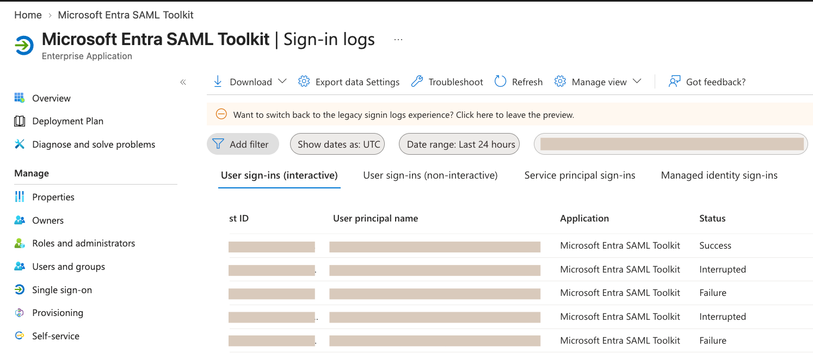

# SAML Single Sign-On (SSO) Integration — Meridian Payments, Inc.

A hands-on SAML 2.0 Single Sign-On integration using Microsoft Entra ID and the Microsoft Entra SAML Toolkit. Demonstrates federated authentication, application access management, troubleshooting, and verified login.

**Video walkthrough:** Coming soon.

---

## Overview

Building on the previous IAM projects at the fictional Meridian Payments, this project configures Single Sign-On so an employee can authenticate to an application using their organizational credentials instead of a separate application password.

- **Identity Provider (IdP):** Microsoft Entra ID
- **Service Provider (SP):** Microsoft Entra SAML Toolkit
- **Test user:** Dana Whitfield, an existing employee carried over from the JML project

## Configuration

- Added the Microsoft Entra SAML Toolkit as an enterprise application.
- Configured the Entity ID, Reply URL (ACS), and SP-initiated Login URL.
- Configured the identity provider's SAML settings and uploaded the signing certificate to the SAML Toolkit to establish trust.
- Verified that the NameID claim used the user's principal name (UPN) in email-address format, matching the test account registered with the service provider.
- Assigned the test user directly to the application. Group-based enterprise application assignment requires a premium Entra ID license and was outside the scope of this project.

## Troubleshooting

During initial testing, the sign-in was denied with error **AADSTS50105** (user not assigned to the application). I traced the error to a missing application assignment, assigned Dana, confirmed the assignment, and successfully retested authentication.

The denied sign-in also demonstrated that the application's assignment requirement was working as intended, preventing an unassigned user from accessing the application.

## Results & Verification

After correcting the assignment, Dana Whitfield successfully authenticated through Microsoft Entra ID and accessed the SAML Toolkit without entering a separate application password.

The successful authentication was verified through Microsoft Entra ID sign-in logs.

*Successful application sign-in recorded in Microsoft Entra ID. Account and tenant identifiers redacted.*

**Result: Successful SAML SSO integration and authentication.**

## Key Takeaway

Hands-on experience configuring federated authentication between an IdP and SP, managing application access, interpreting and resolving a real authentication error, and verifying successful sign-ins through Microsoft Entra ID logs.
